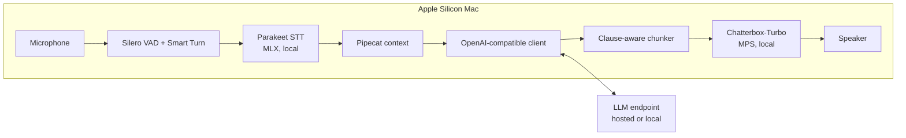

# Parrotbox

**A low-latency, voice-cloning conversational agent built for Apple Silicon.**

Parrotbox keeps speech recognition and speech synthesis on the Mac: microphone
audio is transcribed with Parakeet on MLX, sent to a hosted **or local**
OpenAI-compatible LLM endpoint, and spoken with a Chatterbox-Turbo voice clone
on MPS. [Pipecat](https://github.com/pipecat-ai/pipecat) orchestrates the
streaming pipeline, interruptions, turn detection, and conversation state.

> This is an engineering prototype for one user on macOS, not a hosted product.
> It deliberately targets Apple Silicon rather than pretending to be portable.

## Engineering highlights

- **Local speech stack:** Parakeet TDT 0.6B v3 on MLX for STT and
  Chatterbox-Turbo on MPS for voice-cloned TTS.
- **Responsive conversation:** smart turn detection, barge-in, eager clause
  chunking, and live synthesis controls without model reloads.
- **Honest interruption state:** assistant history is recorded after audio
  output, so an interrupted reply contains only words the user actually heard.
- **Measured, not guessed:** per-turn STT/LLM/TTS latency, playback gaps, and
  per-chunk real-time factor are written to JSONL for analysis.
- **Provider-neutral LLM boundary:** DeepSeek and OpenRouter profiles are built
  in; any OpenAI-compatible server can be supplied with environment variables.

## Architecture



The LLM is a replaceable endpoint, not an on-device claim. STT, turn detection,
voice conditioning, and TTS run locally. See [ARCHITECTURE.md](ARCHITECTURE.md)
for pipeline mechanics and design trade-offs.

## Performance snapshot

Measurements below are from the documented reference setup (18 GB Apple
Silicon MacBook Pro, pinned dependencies). They are evidence of the tuning
process, not universal guarantees.

| Stage | Observed result | Notes |
|---|---:|---|
| Parakeet STT finalize | 244–256 ms warm | 4.9 s clean test clip |
| DeepSeek first content token | ~1.0–1.15 s | Network and provider dependent |
| Chatterbox-Turbo synthesis | 0.73–0.97 RTF warm | MPS, batch synthesis |
| End of speech → first audio | ~2.6–3.0 s typical | Sum of measured dominant components |

The repository includes repeatable stage checks and machine-readable turn
metrics. Methodology, caveats, and tuning guidance live in
[docs/PERFORMANCE.md](docs/PERFORMANCE.md).

## Requirements

| Requirement | Why |
|---|---|
| macOS on Apple Silicon (M-series) | MLX STT and MPS TTS are first-class targets |
| Python 3.12+ | Declared in `pyproject.toml` |
| ~6 GB free unified memory | Models remain resident during a session |
| 16 GB system memory recommended | Leaves practical headroom for macOS and the endpoint client |
| [`uv`](https://docs.astral.sh/uv/) | Dependency and lockfile management |
| PortAudio and Rubber Band | Microphone I/O and pitch-preserving speed control |
| OpenAI-compatible LLM endpoint | Hosted service or a server you run locally |

Intel Macs, Windows, and Linux are not supported by the current MLX/MPS
implementation. `pyproject.toml` and `uv.lock` are the dependency source of
truth; there is intentionally no duplicate `requirements.txt`.

## Quick start

Install system and Python dependencies:

```bash
brew install portaudio rubberband
uv sync --frozen
```

Choose one LLM configuration:

```bash
# DeepSeek direct
export DEEPSEEK_API_KEY=...

# Or OpenRouter
export OPENROUTER_API_KEY=...

# Or any hosted/local OpenAI-compatible server
export LLM_BASE_URL=http://127.0.0.1:8000/v1
export LLM_MODEL=your-model-name
# Optional when that server requires authentication:
export LLM_API_KEY=...
```

Then launch the Textual interface:

```bash
uv run python main.py
```

On first run, choose **Clone a voice…** and record a sample. Parrotbox creates
several 12-second candidate references, synthesizes the same preview for each,
and lets you select the best one. The selected WAV stays under the gitignored
`voice_ref/` directory.

Use only a voice you own or have explicit permission to reproduce.

## Persona and session controls

The tracked `persona.md` is a fictional example. To keep a real persona out of
Git, create the ignored local override:

```bash
cp persona.md persona.local.md
```

The default interface provides a conversation pane plus live controls for
exaggeration, temperature, CFG weight, playback speed, and volume. It also
supports typed speech, mic mute, context reset, and a meeting mode that listens
silently until asked to respond.

Full instructions—including reference-recording guidance, TUI keys, meeting
mode behavior, audio routing, and configuration—are in
[docs/USAGE.md](docs/USAGE.md).

## Validation

The fast checks do not load speech models:

```bash
python -m unittest discover -s tests -v
uvx ruff check .
uv run python scripts/check_chunking.py
```

The hardware/provider checks exercise one pipeline stage at a time:

```bash
uv run python scripts/check_stt.py
uv run python scripts/measure_ttft.py
uv run python scripts/check_tts.py
```

STT/TTS checks require Apple Silicon and downloaded model weights; the LLM
check uses the configured endpoint and may incur provider cost. CI intentionally
runs only platform-independent unit and static checks.

## Repository guide

| Path | Purpose |
|---|---|
| `main.py` | Session configuration and Pipecat pipeline assembly |
| `stt_parakeet.py` | Local segmented Parakeet/MLX service |
| `tts_chatterbox.py` | Local Chatterbox/MPS service and interruption handling |
| `clause_aggregator.py` | Latency/continuity-aware text chunking |
| `turn_metrics.py` | End-to-end latency and playback-gap instrumentation |
| `tui_app.py` | Textual setup, conversation, and live controls |
| `scripts/` | Stage benchmarks, diagnostics, and reference capture tools |
| `tests/` | Platform-independent configuration and control tests |

## Scope, privacy, and safety

- Voice references, local persona files, logs, and `.env` files are gitignored.
- Audio is processed locally for STT and TTS. Transcribed text is sent to the
  configured LLM endpoint, so that endpoint's privacy terms still apply.
- There is no acoustic echo cancellation. Use headphones for full-duplex
  barge-in or half-duplex mode with open speakers.
- This is a personal prototype, not a hardened multi-user service.

## License

Project code is licensed under the [Apache License 2.0](LICENSE). Dependencies
and model weights retain their own licenses; see [NOTICE](NOTICE), especially
before commercial use.
