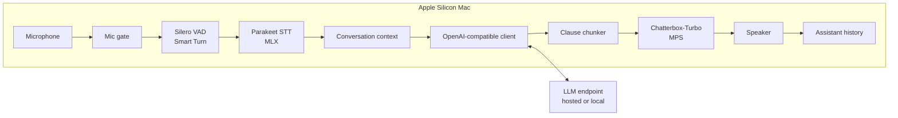

# Parrotbox architecture

Parrotbox is a single-user voice agent for Apple Silicon. It listens through
the Mac's microphone, transcribes speech locally, sends text to an
OpenAI-compatible language model, and speaks the reply in a cloned voice.

This document describes the system that exists today. Benchmark methodology
and tuning results are in [PERFORMANCE.md](PERFORMANCE.md).

## Scope and boundaries

Parrotbox is designed to:

- hold a live spoken conversation with interruption support;
- clone a permitted voice from a short recording;
- apply a user-defined persona from a Markdown file;
- run speech recognition and synthesis on the Mac; and
- work with either a hosted or local OpenAI-compatible LLM endpoint.

It deliberately targets one user on an Apple Silicon Mac. It is not a portable
desktop app, a multi-user service, or an acoustic echo cancellation system.

Audio stays on the Mac for speech recognition and synthesis. The configured
LLM receives the persona, conversation history, and user transcripts. When the
LLM is hosted, that text leaves the Mac.

## Data flow



The diagram shows the logical flow. Pipecat's processor order is slightly
different:

```text
audio input
  → MicGate
  → ParakeetMLXSTTService
  → user context aggregator (VAD + Smart Turn)
  → MeetingGate, when enabled
  → OpenAILLMService
  → ChatterboxTTSService
  → audio output
  → assistant context aggregator
```

The user aggregator sends VAD start and stop frames upstream to the STT
service. This allows the STT processor to appear before the aggregator while
still receiving correctly bounded speech segments.

## Component map

| Component | Implementation | Responsibility |
|---|---|---|
| Audio I/O | Pipecat `LocalAudioTransport` | Capture 16 kHz microphone audio and play 24 kHz output |
| Manual mute | `MicGate` | Drop microphone frames without stopping the audio stream |
| Voice activity | Silero VAD | Detect speech boundaries |
| Turn detection | Smart Turn v3.2 | Decide whether a pause completes the user's turn |
| Speech recognition | `ParakeetMLXSTTService` | Transcribe a completed segment on MLX |
| Conversation state | `LLMContextAggregatorPair` | Store messages and trigger LLM requests |
| Meeting mode | `MeetingGate` | Hold requests until the user asks for a response |
| Language model | Pipecat `OpenAILLMService` | Stream text from the configured endpoint |
| Text chunking | `ClauseEagerAggregator` | Split streamed text into synthesis-sized clauses |
| Text cleanup | `TTSNormalizeFilter` | Convert Markdown and symbols into speakable text |
| Voice synthesis | `ChatterboxTTSService` | Generate cloned-voice audio on MPS |
| Metrics | `TurnMetricsObserver`, `TTSChunkLog` | Record latency, synthesis speed, and playback gaps |
| Interface | Textual | Configure and control the session |

Pipecat provides the pipeline and transport. Parrotbox supplies the local
Parakeet and Chatterbox services.

## How a turn is processed

1. The input transport emits microphone frames.
2. `MicGate` forwards them unless the user has muted the microphone.
3. Silero detects speech. Smart Turn decides when the utterance is complete.
4. Parakeet transcribes the completed audio segment.
5. The user context aggregator appends the transcript to `LLMContext`.
6. The LLM streams a reply. In meeting mode, this step waits until the user
   presses `r`.
7. The clause aggregator sends complete phrases to Chatterbox-Turbo.
8. Chatterbox emits 40 ms audio frames for playback.
9. The assistant context aggregator records the text after it reaches the
   output stage.

The last step is important. History contains what the user heard, not every
token the LLM generated. An interrupted reply therefore leaves an accurate
conversation state.

## Startup and model lifetime

The TUI opens before importing the ML stack. Heavy imports continue in the
background while the setup screen is visible.

When a session starts, Pipecat links the pipeline and loads the models.
Parakeet and Chatterbox perform warm-up work before the session becomes ready,
then remain resident until the app exits.

The voice-clone preview screen temporarily loads its own Chatterbox instance.
It unloads that model before the conversation session starts.

## Latency and parallelism

The path to the first spoken word is serial:

```text
end of speech
  → turn decision
  → STT finalization
  → LLM first content
  → first complete clause
  → TTS generation
  → audio output
```

Reference measurements from an 18 GB Apple Silicon Mac:

| Stage | Observed time | Notes |
|---|---:|---|
| VAD trailing silence | 200 ms | Configured value |
| Smart Turn | 15–30 ms | CPU inference |
| Parakeet finalization | 244–256 ms warm | 4.9 s clean test clip |
| DeepSeek first content | about 1.0–1.15 s | Network and provider dependent |
| First Chatterbox chunk | about 1.0–1.5 s | Warm MPS synthesis |
| Output buffering | about 30–50 ms | Transport and OS buffer |
| End of speech to first audio | about 2.6–3.0 s | Typical total |

After playback begins, work overlaps: one chunk plays while the next chunk
synthesizes and the LLM continues producing text.

The largest remaining latency opportunities are a faster LLM endpoint and
streaming TTS. Streaming STT offers little benefit with the pinned Parakeet
version.

## TTS chunking and playback continuity

Chatterbox-Turbo generates one complete audio chunk per call. Its measured
real-time factor is about 0.9, so one second of audio takes roughly 0.9 seconds
to synthesize.

Playback stays continuous when the next chunk finishes before the current
chunk stops playing:

```text
synthesis_time(next_chunk) <= audio_duration(current_chunk)
```

`ClauseEagerAggregator` uses a ramped policy:

- the first clause can flush after 24 characters;
- each later minimum depends on the length of the previous chunk;
- the minimum grows by 1.25×, capped at 180 characters; and
- splits occur only at clause or sentence boundaries.

In the included simulation, this reduced total playback gaps from 4.94 seconds
to 2.20 seconds without delaying the first chunk. Long sentences without clause
boundaries can still cause gaps. Streaming TTS is the proper fix for that case.

The policy can be adjusted with:

| Variable | Default |
|---|---:|
| `PARROTBOX_MIN_FIRST_CHARS` | 24 |
| `PARROTBOX_MIN_CHUNK_CHARS` | 24 |
| `PARROTBOX_CHUNK_RAMP` | 1.25 |
| `PARROTBOX_MAX_CHUNK_CHARS` | 180 |

## Interruption handling

When the user speaks during playback, Pipecat cancels the LLM stream, clears
pending TTS text, and flushes audio that has not yet played.

Four details matter:

1. **MPS generation cannot be cancelled.** A Chatterbox call already running
   in the worker thread finishes, but its result is discarded.
2. **Audio uses 40 ms frames.** Small frames limit how much queued speech can
   survive an interruption. Audio already inside the OS buffer cannot be
   recalled.
3. **History follows output.** Text that was generated but never played is not
   stored as something the agent said.
4. **Partial text is cleared.** The clause aggregator resets on interruption.

There is no echo cancellation. Full duplex requires headphones. Half-duplex
mode supports open speakers by muting the microphone while Parrotbox talks.

## Turn detection and STT

Current Silero settings:

```text
confidence=0.7
start_secs=0.2
stop_secs=0.2
min_volume=0.6
```

After 200 ms of silence, Smart Turn decides whether the user has finished. If
the utterance appears incomplete, Pipecat waits for more speech for up to 2.5
seconds.

Parakeet runs after the turn ends. It receives the full speech segment as
16-bit PCM, converts it to a float array, and transcribes it on a worker thread
so MLX inference does not block the event loop.

## Streaming STT — evaluated, not shipped

Parakeet MLX 0.5.2 exposes a streaming API, but it re-decodes a draft region
whenever audio is added. On the reference system:

- the default context took about 180–235 ms for each 320 ms audio feed;
- finalization remained about 235 ms, close to batch finalization;
- smaller contexts reduced finalization to 130–150 ms but harmed accuracy; and
- very small contexts still had an observed floor near 90 ms.

The small latency saving did not justify the accuracy loss and continuous
during-speech compute. The current service therefore transcribes one completed
segment. The evaluation remains available through
`scripts/check_stt.py --streaming`.

## LLM, persona, and conversation state

`llm_provider.py` uses DeepSeek by default and accepts any custom
OpenAI-compatible endpoint. A custom endpoint can be hosted or local. The
DeepSeek profile supplies its model default and disables thinking; the custom
profile sends no provider-specific options.

`persona.py` loads `persona.local.md` when present and otherwise uses the
tracked example. Scenario and meeting-mode instructions are appended after the
persona so the main prompt prefix remains stable.

Conversation state is intentionally simple:

- user transcripts and played assistant text accumulate in `LLMContext`;
- typed speech is added even though it bypasses the LLM;
- clearing resets the context to the original system prompt;
- meeting mode accumulates user turns while responses are held; and
- there is no automatic context summarization yet.

## Voice clone reference capture

The TUI records one sample and selects several 12-second windows from it. It
synthesizes the same preview sentence with every candidate so the user can
compare them and save the best one as `voice_ref/reference.wav`.

The reference should be an unprocessed 48 kHz mono WAV recorded in a quiet
room. The directory is gitignored. Only clone a voice you own or have
permission to reproduce.

## Resource use

Reference measurements on an 18 GB unified-memory Mac:

| Component | Framework | Approximate memory |
|---|---|---:|
| Parakeet 0.6B fp16 | MLX | 1.3–1.5 GB |
| Chatterbox-Turbo and vocoder | PyTorch MPS | 2–3 GB |
| Smart Turn v3.2 | ONNX Runtime / CPU | about 50 MB |
| Silero | ONNX Runtime / CPU | about 2 MB |

Normal process usage is roughly 5–6 GB. STT and TTS usually run at different
times, but briefly compete when the user interrupts an in-progress synthesis.
A rising TTS real-time factor over a long session usually indicates thermal
throttling.

## Observability

`TurnMetricsObserver` watches pipeline frames without adding another processor
to the critical path. Each turn produces a readable log line and a JSONL record:

```text
TURN ttfa=2.35s (stt 0.25s | llm 1.04s | tts 1.05s) chunks=3 audio=6.00s gaps=1.60s max=1.60s
```

Metrics include STT, LLM, and TTS latency; total time to first audio; per-chunk
synthesis speed; and silence between playback chunks. Playback gaps are
calculated separately because ordinary time-to-first-byte metrics cannot show
stalls after speech has begun.

## Current limitations

- Apple Silicon and macOS are required by the MLX/MPS implementation.
- Chatterbox synthesis is batch-based, so some long replies pause between chunks.
- An interrupted MPS generation finishes in the background before being discarded.
- Audio-device changes require a session restart.
- Conversation history grows until the user clears it or ends the session.
- Full-duplex use requires headphones because there is no echo cancellation.
- Application-audio routing and multi-speaker meeting behavior are not implemented.

## Version and validation contract

The pipeline is pinned to Pipecat 1.6.0, parakeet-mlx 0.5.2,
chatterbox-tts 0.1.7, and Textual 8.2.8 on Python 3.12 or newer.
`pyproject.toml` and `uv.lock` are the dependency source of truth.

Fast checks:

```bash
python -m unittest discover -s tests -v
uvx ruff check .
uv run python scripts/check_chunking.py
```

Apple Silicon and endpoint checks:

```bash
uv run python scripts/check_stt.py
uv run python scripts/measure_ttft.py
uv run python scripts/check_tts.py
```

The fast checks run in CI. STT and TTS checks require model weights and Apple
hardware. The LLM check calls the configured endpoint and may incur provider
cost.
